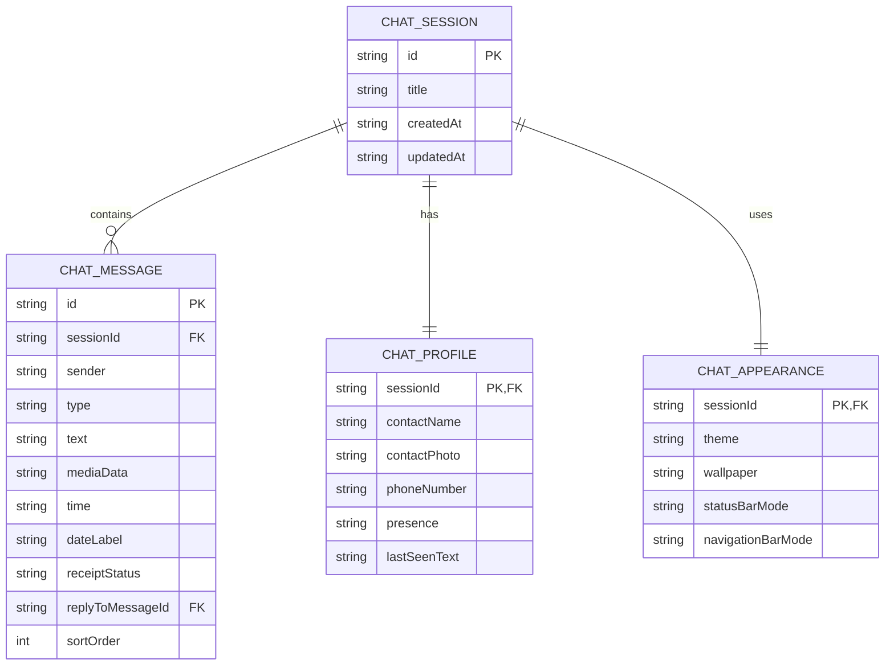

# WA Chat Studio — Project Blueprint

## 1. Ringkasan

**WA Chat Studio** adalah editor simulasi percakapan bergaya WhatsApp Android yang dibuka langsung melalui browser HP. Aplikasi hanya memiliki satu halaman utama: editor chat dengan preview percakapan.

Tujuan utamanya adalah membuat tampilan simulasi yang sedekat mungkin dengan WhatsApp Android, sekaligus memungkinkan pengguna mengubah profil kontak, pesan, waktu, status centang, dan wallpaper.

> Aplikasi ini merupakan simulator independen, bukan WhatsApp resmi. Hasil ekspor sebaiknya diberi penanda “SIMULASI” agar tidak disalahartikan sebagai bukti percakapan asli.

## 2. Prinsip versi pertama

- Mobile-first: prioritas penggunaan di browser Android.
- Satu halaman saja, langsung masuk editor.
- Tidak ada landing page, homepage, login, backend, atau database server.
- Perubahan langsung terlihat pada preview.
- Simpan data lokal di perangkat.
- Export percakapan sebagai PNG.
- UI editor sederhana; area preview chat menjadi fokus utama.

## 3. Fitur MVP

### Profil kontak
- Ganti nama kontak.
- Upload atau ganti foto profil.
- Isi nomor telepon (opsional).
- Atur status: online, mengetik, terakhir dilihat, atau kosong.

### Pesan
- Tambah pesan dari “Saya” atau “Kontak”.
- Edit dan hapus pesan.
- Atur isi pesan dan waktu secara manual.
- Atur status centang: terkirim, diterima, dibaca.
- Urutkan pesan.
- Tambahkan pemisah tanggal.
- Sediakan jenis pesan teks pada MVP; gambar dan reply dapat menjadi tahap berikutnya.

### Tampilan chat
- Tema terang dan gelap.
- Pilih wallpaper bawaan atau gambar sendiri.
- Header kontak bergaya WhatsApp Android.
- Bubble pesan masuk dan keluar.
- Timestamp dan centang di dalam bubble.
- Area input bergaya WhatsApp.
- Status bar simulasi dan navigation bar Android.

### Status bar perangkat
Karena aplikasi berjalan di browser, jam lokal bisa mengikuti waktu HP. Browser web biasa tidak menyediakan akses umum untuk membaca persentase baterai, nama operator, kekuatan sinyal, atau ikon sistem Android secara bebas. Karena itu:
- Jam status bar diambil dari waktu perangkat.
- Ikon sinyal, Wi-Fi, dan baterai dibuat sebagai elemen visual simulasi.
- Jangan mengklaim data baterai atau jaringan sebagai data real-time perangkat.

### Ekspor dan penyimpanan
- Export preview sebagai PNG.
- Simpan sesi ke LocalStorage atau IndexedDB.
- Import/export file JSON agar sesi dapat dipindahkan.
- Pastikan gambar yang diunggah tetap tersedia setelah sesi dibuka kembali.

## 4. Rancangan layar

Pada layar HP, gunakan susunan sederhana:
1. Toolbar kecil: nama aplikasi, tombol simpan, dan export.
2. Preview chat sebagai area terbesar.
3. Tombol/tab “Profil”, “Pesan”, dan “Tampilan” untuk membuka panel pengaturan.
4. Form editor muncul sebagai panel bawah atau drawer agar preview tetap terlihat.

Pada layar lebih lebar, panel pengaturan dapat diletakkan di samping preview.

## 5. ERD / model data

Versi pertama tidak membutuhkan database relasional. Diagram berikut adalah **model relasi data konseptual** untuk struktur objek lokal yang disimpan di perangkat. Diagram ini bisa menjadi dasar jika kelak aplikasi membutuhkan database.



### Catatan entitas
- `CHAT_SESSION`: satu sesi/proyek percakapan.
- `CHAT_PROFILE`: identitas kontak untuk sesi tersebut.
- `CHAT_APPEARANCE`: tema dan wallpaper sesi.
- `CHAT_MESSAGE`: kumpulan pesan dalam sesi.
- `replyToMessageId`: opsional, untuk fitur balas pesan di tahap lanjutan.
- `mediaData`: opsional; dapat berupa data URL atau referensi aset lokal. Hindari menyimpan file gambar besar sebagai teks di LocalStorage; gunakan IndexedDB.

## 6. Contoh struktur data JSON

```json
{
  "id": "session-001",
  "title": "Simulasi percakapan",
  "profile": {
    "contactName": "Nama Kontak",
    "contactPhoto": null,
    "phoneNumber": "",
    "presence": "online",
    "lastSeenText": ""
  },
  "appearance": {
    "theme": "light",
    "wallpaper": "default",
    "statusBarMode": "device-clock",
    "navigationBarMode": "android"
  },
  "messages": [
    {
      "id": "message-001",
      "sender": "contact",
      "type": "text",
      "text": "Halo!",
      "time": "19:30",
      "dateLabel": "Hari ini",
      "receiptStatus": "received",
      "replyToMessageId": null,
      "sortOrder": 1
    },
    {
      "id": "message-002",
      "sender": "me",
      "type": "text",
      "text": "Hai, apa kabar?",
      "time": "19:31",
      "dateLabel": "Hari ini",
      "receiptStatus": "read",
      "replyToMessageId": null,
      "sortOrder": 2
    }
  ]
}
```

## 7. Teknologi yang disarankan

- React + Vite
- CSS biasa atau Tailwind CSS
- Zustand (opsional) untuk state editor
- Lucide React untuk ikon
- `html-to-image` untuk export PNG
- LocalStorage untuk data ringan
- IndexedDB untuk foto dan aset lokal berukuran lebih besar

Jangan menambahkan backend atau database server pada MVP.

## 8. Struktur folder awal

```text
wa-chat-studio/
├── public/
│   └── wallpapers/
├── src/
│   ├── components/
│   │   ├── ChatPreview.jsx
│   │   ├── ChatHeader.jsx
│   │   ├── MessageBubble.jsx
│   │   ├── StatusBar.jsx
│   │   ├── NavigationBar.jsx
│   │   └── EditorSheet.jsx
│   ├── features/
│   │   ├── profile/
│   │   ├── messages/
│   │   └── appearance/
│   ├── store/
│   │   └── chatStore.js
│   ├── utils/
│   │   ├── storage.js
│   │   └── exportImage.js
│   ├── App.jsx
│   ├── main.jsx
│   └── index.css
└── package.json
```

## 9. Urutan pengerjaan

1. Buat project React + Vite.
2. Bangun satu halaman editor mobile-first.
3. Buat preview WhatsApp Android: status bar simulasi, header, wallpaper, bubble, timestamp, centang, input, dan navigation bar.
4. Buat editor profil kontak.
5. Buat tambah/edit/hapus pesan dan pengaturan waktu/status centang.
6. Buat tema dan wallpaper.
7. Buat penyimpanan lokal dan import/export JSON.
8. Buat export PNG dan uji hasil pada beberapa ukuran layar Android.

## 10. Kriteria selesai MVP

- Website langsung membuka editor, tanpa homepage.
- Nyaman digunakan di browser HP Android.
- Preview berubah langsung saat pengaturan diedit.
- Nama dan foto kontak dapat diubah.
- Pesan dapat ditambah, diedit, dihapus, dan diurutkan.
- Waktu dan status centang dapat diatur per pesan.
- Tema dan wallpaper dapat diganti.
- Sesi dapat disimpan dan dibuka kembali di perangkat.
- PNG hasil ekspor tajam dan tidak memotong chat.
- Elemen status bar yang tidak dapat dibaca browser ditampilkan sebagai simulasi, bukan diklaim sebagai data perangkat asli.

## 11. Prompt awal untuk coding AI

Buat project web bernama **WA Chat Studio** menggunakan React + Vite. Aplikasi adalah editor simulasi percakapan bergaya WhatsApp Android dan harus mobile-first karena akan digunakan langsung dari browser HP Android.

Batasan wajib:
- Langsung tampilkan satu halaman editor; jangan buat landing page, homepage, login, dashboard, backend, atau database server.
- Prioritaskan kemiripan visual dengan antarmuka chat WhatsApp Android: header, bubble, warna, radius, jarak, timestamp, centang, wallpaper, kolom input, status bar simulasi, dan navigation bar.
- Jangan menyalin logo resmi atau mengesankan aplikasi ini sebagai WhatsApp resmi.
- Buat preview yang responsif dan menjadi fokus utama.
- Untuk layar HP, gunakan toolbar ringkas dan panel pengaturan berbentuk bottom sheet/tab agar preview tidak tertutup permanen.
- Buat komponen terpisah dan kode yang mudah dirawat.
- Gunakan data contoh secukupnya.
- Jangan menambahkan fitur di luar ruang lingkup MVP.
- Jam status bar boleh mengikuti waktu lokal perangkat. Baterai, sinyal, dan Wi-Fi harus berupa indikator simulasi karena browser web tidak memiliki akses umum untuk membaca status sistem Android tersebut.
- Jangan menganggap tahap selesai sebelum layout mobile, edit pesan, edit profil, dan preview langsung berfungsi.

Mulai dengan membuat fondasi layout dan preview chat terlebih dahulu. Setelah itu lanjutkan fitur satu per satu tanpa merusak bagian yang sudah berfungsi.
